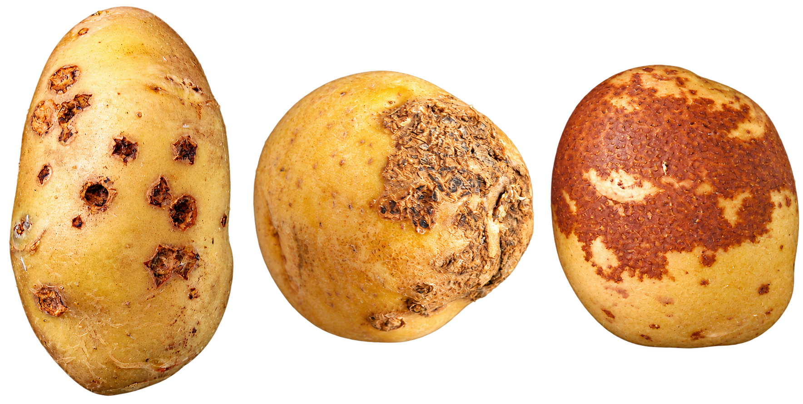

  

<h1 align="center">Potato Common Scab</h1>

  <b>Hemant B Kardile, Vinay Sagar, Sanjeev Sharma, Vinod Kumar, Brajesh Singh</b> 
  <i>ICAR-CPRI, Shimla</i>

Potato common scab is a disease that affects the skin of potato tubers, producing rough, corky lesions that may be superficial, raised or deeply pitted. It is associated with pathogenic bacteria belonging to the genus <em>Streptomyces</em>.

Although common scab often has a greater effect on tuber appearance and market quality than on yield, severe symptoms can reduce the commercial value of potatoes.

Understanding how the disease develops and how symptoms appear on tubers is therefore essential for its early identification and effective management. The following modules discuss the causal organisms, disease development, characteristic symptoms, and factors influencing disease severity.

1. [Introduction to Common Scab](Module1)
2. [Causal Organism and Disease Development](Module2)
3. [Identification of Common Scab Symptoms](Module3)
4. [Factors Favouring Disease Development](Module4)
5. [Disease Management Practices](Module5)
6. [Farmer Advisory and Important Recommendations](Module6)

